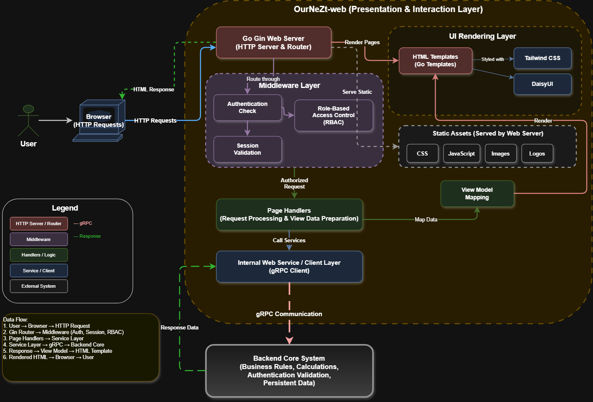

<a id="readme-top"></a>

<!-- PROJECT SHIELDS -->
<p align="center">
  <a href="https://github.com/OurNeZt/OurNeZt-web/actions/workflows/ci.yaml">
    
  </a>
  <a href="https://github.com/OurNeZt/OurNeZt-web/releases">
    
  </a>
  <a href="https://github.com/OurNeZt/OurNeZt-web/blob/stable/LICENSE">
    
  </a>
  <a href="https://github.com/OurNeZt/OurNeZt-web/pkgs/container/ournezt-web">
    
  </a>
</p>

<!-- PROJECT LOGO -->
<br />
<div align="center">
  <a href="https://github.com/OurNeZt/OurNeZt-web">
    
  </a>

  <h1 align="center">OurNeZt Web</h1>

  <p align="center">
    Browser-facing web application for household finance, housing planning, and family dashboard workflows.
    <br />
    <br />
    <a href="https://github.com/OurNeZt/OurNeZt-web/issues/new?labels=bug&template=bug-report.md">Report Bug</a>
    &middot;
    <a href="https://github.com/OurNeZt/OurNeZt-web/issues/new?labels=enhancement&template=feature-request.md">Request Feature</a>
    &middot;
    <a href="https://github.com/OurNeZt/OurNeZt-web/releases">Releases</a>
  </p>
</div>

---

<!-- TABLE OF CONTENTS -->
<details>
  <summary>Table of Contents</summary>
  <ol>
    <li>
      <a href="#about-the-project">About The Project</a>
      <ul>
        <li><a href="#what-it-does">What It Does</a></li>
        <li><a href="#built-with">Built With</a></li>
      </ul>
    </li>
    <li><a href="#architecture-overview">Architecture Overview</a></li>
    <li>
      <a href="#getting-started">Getting Started</a>
      <ul>
        <li><a href="#prerequisites">Prerequisites</a></li>
        <li><a href="#installation">Installation</a></li>
        <li><a href="#configuration">Configuration</a></li>
      </ul>
    </li>
    <li><a href="#authentication-protections">Authentication Protections</a></li>
    <li><a href="#http-request-protections">HTTP Request Protections</a></li>
    <li><a href="#core-request-deadlines">Core Request Deadlines</a></li>
    <li><a href="#running-the-web-app">Running The Web App</a></li>
    <li>
      <a href="#testing">Testing</a>
      <ul>
        <li><a href="#http-protection-regression-tests">HTTP Protection Regression Tests</a></li>
        <li><a href="#core-deadline-regression-tests">Core Deadline Regression Tests</a></li>
        <li><a href="#session-revocation-regression-tests">Session Revocation Regression Tests</a></li>
        <li><a href="#reviewer-check-against-a-running-web-instance">Reviewer Check Against A Running Web Instance</a></li>
      </ul>
    </li>
    <li><a href="#docker">Docker</a></li>
    <li><a href="#release-flow">Release Flow</a></li>
    <li><a href="#roadmap">Roadmap</a></li>
    <li><a href="#contributing">Contributing</a></li>
    <li><a href="#license">License</a></li>
    <li><a href="#contact">Contact</a></li>
  </ol>
</details>

---

## About The Project

**OurNeZt Web** is the web application layer for the OurNeZt ecosystem. It provides the browser-facing interface for household finance planning, family management, person profiles, income visibility, housing affordability workflows, and dashboard views.

This repository is designed to act as the main web client for OurNeZt. It uses Go with Gin for the web server and routing layer, while DaisyUI and Tailwind CSS are used for styling the user interface. The web app is intended to communicate with **OurNeZt Core** through gRPC, keeping the frontend/web layer separated from the backend domain logic.

<p align="right">(<a href="#readme-top">back to top</a>)</p>

---

## What It Does

OurNeZt Web currently focuses on the user-facing experience for:

- Login, session handling, and authenticated web access.
- Server-side logout revocation and fresh login after password changes.
- Admin-created user onboarding and first-time password flow.
- Family and household dashboard views.
- Family creation, joining, invite code, and member management workflows.
- Person profile forms for household members.
- Income, CPF, cash savings, expenses, and surplus display.
- Housing option forms for BTO, resale, EC, private, and other housing types.
- Housing groups with individual and group-level dashboard visibility controls.
- Family-scoped housing checklists, weighted criteria, ratings, and evaluation summaries.
- Housing notes for viewing observations and planning context.
- Housing affordability dashboards, comparisons, charts, and timelines powered by backend calculations.
- Authentication throttling by client IP and normalized account identity.
- Bounded request bodies, multipart forms, and HTTP connection timeouts.
- Consistent Core RPC deadlines and safe timeout or service unavailable messages.
- Responsive web pages styled with DaisyUI and Tailwind CSS.

The web app is built as a lightweight server-rendered Go application. It should remain focused on routing, templates, page rendering, user interaction, and calling the backend Core service instead of duplicating finance or housing business logic.

---

## Built With

<p align="left">
  
  
  
  
  
  
  
  
  
</p>

<p align="right">(<a href="#readme-top">back to top</a>)</p>

---

## Architecture Overview

<p align="center">
  
</p>

OurNeZt Web is designed as the browser-facing application layer for the OurNeZt platform. Users interact with the web interface through a browser, while the Gin web server handles routing, middleware, sessions, templates, static assets, and page rendering.

At the centre of the web architecture is the **OurNeZt Web Server**, which acts as the bridge between the browser and the backend Core service. The web app should not own the main business rules for CPF, housing affordability, dashboard aggregation, or household finance calculations. Instead, it calls **OurNeZt Core** over gRPC and renders the returned data into user-friendly pages.

The web application is split into focused areas:

- **Web Router** handles HTTP routes, page navigation, redirects, and route grouping.
- **Middleware Layer** handles request logging, authentication throttling, bounded request body validation, session checks, and authentication guards.
- **Template Layer** renders HTML pages, layouts, partials, forms, and reusable UI components.
- **Static Asset Layer** serves compiled CSS, JavaScript, images, and application assets.
- **gRPC Client Layer** communicates with OurNeZt Core for authentication, family, person, finance, housing, and dashboard data.
- **UI Pages** provide user-facing screens for login, dashboards, family management, profile management, housing planning, and affordability summaries.

The expected flow is:

```text
Browser
  -> OurNeZt Web HTTP/Gin Server
  -> Authentication traffic limits and request body validation
  -> Auth/session middleware
  -> Page handler
  -> OurNeZt Core gRPC API
  -> PostgreSQL through Core
  -> Core response
  -> HTML template rendered by Web
  -> Browser
```

This keeps the web repository focused on user experience, page composition, and frontend interaction, while the Core repository remains responsible for backend APIs, domain logic, persistence, and calculations.

<p align="right">(<a href="#readme-top">back to top</a>)</p>

---

## Getting Started

### Prerequisites

Install the following tools:

- Go
- Docker
- A running OurNeZt Core service

Optional but recommended:

- `make`
- `grpcurl`
- Docker Compose

---

### Installation

Clone the repository:

```bash
git clone git@github.com:OurNeZt/OurNeZt-web.git
cd OurNeZt-web
```

Install Go dependencies:

```bash
go mod download
```

Run tests:

```bash
go test ./...
```

<p align="right">(<a href="#readme-top">back to top</a>)</p>

---

## Configuration

The web app is configured using environment variables.

Example:

```bash
export APP_ENV=development
export WEB_ADDR=:8080
export CORE_GRPC_ADDR=localhost:50051
export SESSION_COOKIE_NAME=ournezt_session
export SESSION_COOKIE_MAX_AGE=12h
export SESSION_COOKIE_SECURE=false
export REQUEST_TIMEOUT=5s
export MAINTENANCE_NOTICE_ENABLED=false
```

See [.env.example](.env.example) for common settings. The HTTP timeout and body size defaults are documented in [HTTP Request Protections](#http-request-protections).

### Environment Variables

| Variables | Description | Example |
| --- | --- | --- |
| `APP_ENV` | Application environment. Usually `development` or `production`. | `development` |
| `WEB_ADDR` | HTTP bind address for the Gin web server. | `:8080` |
| `CORE_GRPC_ADDR` | Address of the running OurNeZt core gRPC service. | `localhost:50051` |
| `SESSION_COOKIE_NAME` | Name of the browser session cookie. | `ournezt_session` |
| `SESSION_COOKIE_MAX_AGE` | Session cookie lifetime. | `12h` |
| `SESSION_COOKIE_SECURE` | Whether the session cookie requires HTTPS. Set to `true` in production. | `false` |
| `REQUEST_TIMEOUT` | Shared Core RPC budget per HTTP request and maximum duration of an individual Core RPC; defaults to `5s`. | `5s` |
| `SHUTDOWN_TIMEOUT` | Graceful shutdown timeout; defaults to `10s`. | `10s` |
| `WEB_TLS_CERT_FILE` / `WEB_TLS_KEY_FILE` | Certificate and private key for optional HTTPS on the Web listener. Configure both. | `/etc/ournezt/tls/tls.crt` / `/etc/ournezt/tls/tls.key` |
| `CORE_GRPC_USE_TLS` | Enable TLS for Web-to-Core gRPC; defaults to `false`. | `true` |
| `CORE_GRPC_TLS_CA_FILE` | Optional CA certificate file for the Core connection. | `/etc/ournezt/tls/ca.crt` |
| `CORE_GRPC_TLS_SERVER_NAME` | Optional server name for Core TLS verification. | `ournezt-core` |
| `MAINTENANCE_NOTICE_FILE` | Optional JSON file path for a dynamically loaded maintenance notice. File values override env values and are read on each page render. | `/etc/ournezt/maintenance-notice/notice.json` |
| `MAINTENANCE_NOTICE_ENABLED` | Shows or hides the maintenance banner when no notice file is configured. | `true` |
| `MAINTENANCE_NOTICE_LEVEL` | Banner style. Supported values: `info`, `success`, `warning`, `error`. | `warning` |
| `MAINTENANCE_NOTICE_TITLE` | Optional short banner title. | `Planned maintenance` |
| `MAINTENANCE_NOTICE_MESSAGE` | Main maintenance banner copy. | `OurNeZt may be unavailable on 28 Jun 2026, 12:00 AM to approximately 2:00 AM SGT while we migrate ingress traffic.` |
| `MAINTENANCE_NOTICE_STARTS_AT` | Optional human-readable maintenance start time. | `28 Jun 2026, 12:00 AM SGT` |
| `MAINTENANCE_NOTICE_ENDS_AT` | Optional human-readable maintenance end time. | `28 Jun 2026, approximately 2:00 AM SGT` |

### Maintenance Notice File
For hot-swappable maintenance copy, set `MAINTENANCE_NOTICE_FILE` to a JSON file. The app reads the file on each page render, so a mounted Kubernetes ConfigMap can be edited without rebuilding the web image.

```json
{
  "enabled": true,
  "level": "warning",
  "title": "Planned maintenance",
  "message": "OurNeZt may be unavailable on 28 Jun 2026, 12:00 AM to approximately 2:00 AM SGT while we migrate ingress traffic.",
  "starts_at": "28 Jun 2026, 12:00 AM SGT",
  "ends_at": "28 Jun 2026, approximately 2:00 AM SGT"
}
```

### Session Behaviour

OurNeZt Web stores the session token in an HTTP-only browser cookie. For authenticated backend calls, the token is forwarded to OurNeZt Core as gRPC metadata: `x-session-token: <session-token>`

If OurNeZt Core returns that a user must change their password, the web app redirects the user to: `/change-password`. This ensures bootstrap-created admin users and password-reset users update their password before continuing to other authenticated pages.

Logout calls Core’s `RevokeCurrentSession` RPC with the browser token before clearing the cookie. Repeated logout remains safe even when the token has expired or was already revoked. If Core cannot confirm revocation, Web keeps the cookie, displays a safe error, and offers **Retry logout**. Logout uses the shared Core request deadline and does not perform a preliminary session validation call.

After a successful password change through either `/change-password` or `/profile/password`, Core has revoked all sessions for that user. Web clears the cookie and redirects to login with a confirmation. Failed password changes keep the cookie. This also applies to the first-login password-change flow.

Deploy the matching Core change before updating Web. The existing `revoked_at` database column supports this behavior; no new schema migration or Web environment setting is needed.

---

## Authentication Protections

Failed logins display only `Invalid email or password.` Web uses the same redirect and rendered message for unknown emails, wrong passwords, disabled accounts, lookup failures, and other Core login errors. It never displays raw Core login error messages or sets a session cookie after failure. Missing email or password uses the same message. Authentication throttling still returns HTTP 429 with retry information.

Deploy the matching Core fix for [core #54](https://github.com/OurNeZt/OurNeZt-core/issues/54) to normalize gRPC login responses and perform bounded dummy Argon2id verification for unknown accounts. Web's message protection works independently, but Core is needed to reduce backend timing differences.

Run the login response and traffic limit regression checks without a Core deployment:

```bash
go test ./internal/web -run 'TestLogin|TestAuthenticationRouteLimits|TestWebAuthenticationConcurrencyCap' -count=1 -v
```

### Login Enumeration Reviewer Checks

Start Web and Core on a local/staging instance with an existing active test account. Optionally create a second test account through the admin UI and disable it. Supply those fixture emails below; the checker does not create or disable accounts, and never asks for a real password:

```bash
go run ./cmd/login-enumeration-check -url http://localhost:8080 -email active@example.com -disabled-email disabled@example.com
```

Replace the example emails with your fixtures. The command generates an unknown email and a random wrong password, then submits two or three failed logins. It requires the same HTTP 302 redirect to `Invalid email or password.`, identical response bodies and rendered login pages, and no `Set-Cookie`. It prints `PASS` for each case and exits nonzero on failure. Omitting `-disabled-email` explicitly reports that case as `SKIP`. These requests consume authentication limit slots; a 429 fails the check with a retry instruction.

This checks Web's public responses. A generic Web response alone cannot prove Core connectivity or account fixture state. Confirm Core is running and use the Core regression command in its README to verify matching gRPC responses, successful login, and dummy Argon2 work. Lookup failures are injected by automated tests; they do not require breaking a running database. Timing is verified by checking the password work and configured cost, without a flaky wall-clock threshold.

The reviewer checker itself is tested against the application router, plus simulated endpoints that leak messages, set cookies, return different bodies, succeed unexpectedly, throttle, redirect elsewhere, or return an HTTP outage:

```bash
go test ./cmd/login-enumeration-check ./internal/web -run 'TestReviewerCheck|TestLogin' -count=1 -v
```

Authentication submissions are limited before expensive Core calls. Web applies these defaults per running instance:

| Environment variable | Default | Purpose |
| --- | --- | --- |
| `AUTH_IP_LIMIT` | `30` | Authentication submissions per client IP within the window. |
| `AUTH_ACCOUNT_LIMIT` | `5` | Submissions per normalized account identity within the window. |
| `AUTH_RATE_WINDOW` | `1m` | Rate limit window. |
| `AUTH_MAX_CONCURRENT` | `8` | Concurrent authentication submissions. |
| `WEB_TRUSTED_PROXIES` | Empty | Comma-separated proxy IPs or CIDRs allowed to supply forwarded client IPs. |

Rejected submissions return **HTTP 429** with `Retry-After` and `Cache-Control: no-store`. Limits cover login, password changes, and admin user creation. Set `WEB_TRUSTED_PROXIES` to the actual ingress proxy source addresses when running behind a reverse proxy; the empty default ignores forwarded headers. Core also enforces its own authentication limits.

---

## HTTP Request Protections

The Web server bounds request bodies and connection I/O with the following defaults:

| Environment variable | Default | Purpose |
| --- | --- | --- |
| `WEB_READ_HEADER_TIMEOUT` | `10s` | Maximum time to read request headers. |
| `WEB_READ_TIMEOUT` | `15s` | Maximum time to read the entire request, including its body. |
| `WEB_WRITE_TIMEOUT` | `30s` | Deadline for response writes. |
| `WEB_IDLE_TIMEOUT` | `60s` | Maximum idle time between keep-alive requests. |
| `WEB_MAX_REQUEST_BODY_BYTES` | `1048576` (1 MiB) | Maximum body size for every request, including multipart requests. |

Timeouts must be positive Go durations, and the body limit must be a positive integer in bytes. Missing, invalid, zero, or negative values retain the protective defaults.

Login, password changes, and admin user creation retain a smaller **16 KiB** body limit, even if the global limit is increased. A smaller global limit also applies to these routes.

Bodies are completely checked within the size cap before session validation or handlers can use form data. This also bounds requests without a Content-Length, including chunked uploads. Oversized bodies return **HTTP 413**, malformed forms return **HTTP 400**, and body read timeouts return **HTTP 408** when a response can still be written. Multipart parsing uses bounded memory and cleans up any temporary form files. Normal housing notes, including 10,000 characters of Unicode text, fit within the default limit.

`WEB_WRITE_TIMEOUT` bounds connection writes; it does not cancel handler work. `REQUEST_TIMEOUT` controls the separate Core RPC budget described below. These limits apply to both plaintext and TLS listeners.

Use the [regression tests](#http-protection-regression-tests) to verify connection timeouts and the [reviewer command](#reviewer-check-against-a-running-web-instance) to check body limits on a running instance.

---

## Core Request Deadlines

`REQUEST_TIMEOUT` defaults to **5 seconds** and bounds every Web-to-Core RPC, including session validation, authentication, dashboard, family, person, housing, income, CPF, admin, and account operations. Missing, invalid, zero, or negative values fall back to the default.

After request body validation, Web creates one deadline shared by session validation and subsequent business RPCs. A page with several sequential calls uses the remaining budget rather than receiving a fresh timeout for each call. Earlier request deadlines and client cancellation are preserved, along with the session metadata sent to Core. The Core client also applies a per-call deadline, protecting calls made outside the HTTP middleware, and cancels its timeout context when each call completes.

Session validation timeouts return an HTML **504 Gateway Timeout** page; unavailable Core responses return **503 Service Unavailable**. These responses include `Cache-Control: no-store` and preserve the session cookie. Business handlers show safe error messages through their existing error redirects; page rendering also detects timeout or unavailable errors from optional RPCs, preventing incomplete backend data from appearing as a successful page. Internal gRPC connection details are not exposed in these messages. Unsaved housing notes, evaluation answers, and checklist criteria remain available to copy or retry after a timeout.

`WEB_WRITE_TIMEOUT` controls response writes separately. Keep it longer than `REQUEST_TIMEOUT` so Web can send an error after a Core deadline expires. See the [gRPC deadline guide](https://grpc.io/docs/guides/deadlines/) for background.

---

## Running The Web App

Run locally:

```bash
go run ./cmd/web
```

The web server should start using the configured bind address.

Example:

```bash
open http://localhost:8080
```

<p align="right">(<a href="#readme-top">back to top</a>)</p>

---

## Testing

Run all tests:

```bash
go test ./...
```

Run tests with verbose output:

```bash
go test -v ./...
```

Run tests with coverage:

```bash
go test -v -cover ./...
```

Generate an HTML coverage report:

```bash
go test -coverprofile=coverage.out ./...
go tool cover -html=coverage.out
```

### HTTP Protection Regression Tests

Run the focused checks without a running Core service or database:

```bash
go test ./cmd/http-limits-check ./internal/config ./internal/web -run 'TestHTTP|TestRequestBody|TestBoundedMultipart|TestRouterRejects|TestMaximumHousingNotes' -count=1 -v
```

These tests cover:

- Default, custom, invalid, and nonpositive configuration values.
- Known-length and chunked bodies, exact size boundaries, and the smaller authentication limit.
- Malformed forms, bounded multipart parsing, temporary file cleanup, and 10,000-character Unicode housing notes.
- Rejection before session validation or Core calls.
- Real socket checks for slow headers, slow bodies, stalled chunked uploads, idle keep-alive connections, and response write deadlines.
- TLS/HTTP2 oversized body rejection.
- The reviewer command against the actual application router, an endpoint missing chunked protection, and unfixed or unavailable endpoints.

### Core Deadline Regression Tests

Run the deadline checks without a separate Core deployment or database:

```bash
go test ./internal/config ./internal/core ./internal/web -run 'TestRPC|TestCore|TestRequestTimeout' -count=1 -v
```

The tests start a local gRPC server that deliberately stalls. They verify deadlines for every Core service, unavailable connections with wait-for-ready enabled, shared budgets across sequential HTTP calls, earlier caller deadlines, cancellation, session metadata, safe error messages, session cookie preservation, and unsaved housing draft recovery. They also check that an unavailable backend cannot render an empty family list as a successful page.

### Session Revocation Regression Tests

Run the logout and password-change checks without a separate Core deployment:

```bash
go test ./internal/web -run TestSession -count=1 -v
```

These verify revocation before cookie deletion, repeated logout, rejected token reuse, timeout and unavailable Core responses, retry behavior, first-login and normal password changes, and preservation of cookies after failures. Run the matching Core lifecycle and PostgreSQL tests to verify backend invalidation and transaction behavior.

### Reviewer Check Against A Running Web Instance

Start Web as described above, then run this command in another terminal:

```bash
go run ./cmd/http-limits-check -url http://localhost:8080
```

The command prints a `PASS` line for each check and exits with a nonzero status on failure. It verifies that a body exactly at the global cap is accepted, oversized known-length/chunked/multipart bodies return **413**, malformed forms return **400**, and the smaller login body cap still applies. Rejections must also include `Cache-Control: no-store`.

Most probes POST to an intentionally unregistered path, so **404** is the expected result for accepted bodies. One oversized probe targets `/login`; it is rejected before login processing and consumes one authentication IP-limit slot. The command sends no credentials or session cookies and changes no application records.

If the instance uses a custom global body limit, supply the same byte count:

```bash
go run ./cmd/http-limits-check -url http://localhost:8080 -max-body-bytes 2097152 -timeout 15s
```

The checker supports body limits from 64 bytes to 64 MiB. Use a direct local or staging Web listener, or a Kubernetes port-forward to Web, to verify the application limits. An ingress proxy may reject requests first and apply different limits. This command checks body handling; the automated socket tests above verify connection timeouts.

<p align="right">(<a href="#readme-top">back to top</a>)</p>

---

## Docker

Build the image locally:

```bash
docker build -t ournezt-web:local .
```

Run the container:

```bash
docker run --rm \
  -p 8080:8080 \
  -e APP_ENV="production" \
  -e WEB_ADDR=":8080" \
  -e CORE_GRPC_ADDR="host.docker.internal:50051" \
  -e SESSION_COOKIE_NAME="ournezt_session" \
  -e SESSION_COOKIE_MAX_AGE="12h" \
  -e SESSION_COOKIE_SECURE="true" \
  -e REQUEST_TIMEOUT="5s" \
  ournezt-web:local
```

Container startup behavior:

- Starts the Gin web server.
- Serves compiled templates and static assets.
- Connects to OurNeZt Core using `CORE_GRPC_ADDR`.
- Uses browser cookies or session middleware for authenticated page access.

Released images are published to GitHub Container Registry:

```bash
docker pull ghcr.io/OurNeZt/ournezt-web:latest
```

or for a specific release:

```bash
docker pull ghcr.io/OurNeZt/ournezt-web:vX.Y.Z
```

<p align="right">(<a href="#readme-top">back to top</a>)</p>

---

## Release Flow

This repository uses a controlled release flow:

```text
dev -> release/vX.Y.Z -> stable
```

The release process is:

1. Run the `prepare-release` workflow manually.
2. Select the version bump type: `patch`, `minor`, or `major`.
3. The workflow creates a `release/vX.Y.Z` branch and updates `CHANGELOG.md`.
4. Review and update the generated changelog entry.
5. Merge the release PR into `stable`.
6. The `release` workflow creates the Git tag, GitHub Release, and Docker images.

Docker images are tagged as:

```text
ghcr.io/OurNeZt/ournezt-web:vX.Y.Z
ghcr.io/OurNeZt/ournezt-web:latest
```

<p align="right">(<a href="#readme-top">back to top</a>)</p>

---

## Roadmap

- [x] Web application foundation
- [x] Gin server setup
- [x] Tailwind CSS and DaisyUI CDN integration
- [x] HTML template structure
- [x] Static asset handling
- [x] Authentication pages
- [x] Session middleware integration
- [x] Server-side logout and password-change session revocation
- [x] gRPC client integration with OurNeZt Core
- [x] Family and household dashboard pages
- [x] Person profile management pages
- [x] Finance and CPF dashboard views
- [x] Housing affordability planning pages
- [x] Housing groups and dashboard visibility controls
- [x] Housing checklists, evaluations, and notes
- [x] Authentication rate limits and trusted proxy configuration
- [x] Request body limits and HTTP connection timeouts
- [x] Core RPC deadlines and safe dependency failure responses
- [x] Reviewer commands for authentication and request body checks
- [x] Responsive UI polish
- [x] Docker image build and release workflow
- [x] Deployment manifests
- [ ] Observability, metrics, and structured logging

See the [open issues](https://github.com/OurNeZt/OurNeZt-web/issues) for planned improvements and known issues.

<p align="right">(<a href="#readme-top">back to top</a>)</p>

---

## Contributing

Contributions are welcome.

For normal development:

1. Create a feature branch from `dev`.

   ```bash
   git checkout dev
   git pull
   git checkout -b feature/your-feature-name
   ```

2. Make your changes.

3. Run tests and build checks.

   ```bash
   go test ./...
   ```

4. Commit your changes using a conventional commit style.

   ```bash
   git commit -m "feat: add new web capability"
   ```

5. Open a pull request into `dev`.

For release preparation, use the release workflow instead of manually creating tags.

<p align="right">(<a href="#readme-top">back to top</a>)</p>

---

## License

Distributed under the Apache License 2.0. See `LICENSE` for more information.

<p align="right">(<a href="#readme-top">back to top</a>)</p>

---

## Contact

Project Organisation: [OurNeZt](https://github.com/OurNeZt)

Repository: [https://github.com/OurNeZt/OurNeZt-web](https://github.com/OurNeZt/OurNeZt-web)

<p align="right">(<a href="#readme-top">back to top</a>)</p>
